# Northwind ERP

Riiiiiiiight, so I built this app in 30 minutes. First - download [Vantage UI](https://www.vantage-ui.com/), then tell it:

> hi so i want to build a massive ERP system lots of features - comparable to leading ERP
> competition - do it please - use your own judgement. i want all the essentials in and then
> any custom components can be introduced later. take inspiration from SAP, but make it
> user-friendly.

After 10 minutes backend was ready, then I asked:

> ok, now i want you to build web admin - and make it familiar to SAP userss, but very friendly
> and clean at the same time. Don't use all the standard CRUD everywhere - try to approach each
> page differently on the web.

This repository is the result. Don't waste your tokens, use Vantage UI.

----

An ERP that SAP users will recognise, built to be easier to use. It covers sales, CRM,
purchasing, inventory, production, finance and HR for a made-up company, Northwind
Manufacturing, and comes loaded with a year of sample data.

It is a [Vantage](https://github.com/romaninsh/vantage) project. A desktop app is built from
the YAML in this folder, and the web admin is a React app on the same data. The data lives in
SurrealDB, which also enforces the business rules.

**Live demo: https://sap-vg-admin-129027965449.europe-west2.run.app**

> The demo has no sign-in, so anyone with the link can read the data and change it. Treat
> everything in it as sample data.

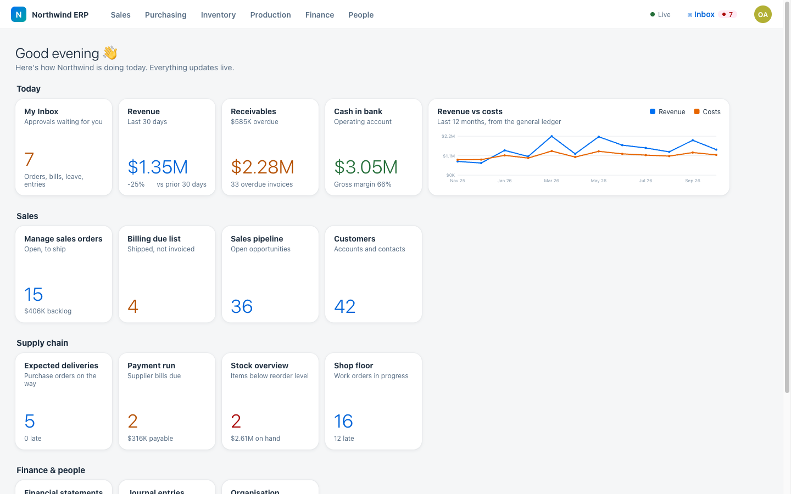

## What's in it

| Area | What you can do |
|---|---|
| Sales | Customers and sales orders with line items, goods issue, billing and payments. The order page tracks each order from order to cash, and receivables are grouped by age |
| CRM | A pipeline of opportunities by stage, weighted by probability |
| Purchasing | Suppliers, purchase orders, goods receipt, supplier bills with an approval step, bill payments |
| Inventory | Products across three warehouses, a stock ledger, reorder levels and a one-click MRP run that drafts purchase orders and work orders |
| Production | Bills of materials and work orders on a shop-floor timeline. Completing an order consumes its components and books the finished goods |
| Finance | Chart of accounts, double-entry journal, general ledger, balance sheet and P&L. Shipments, invoices, bills and payments post to the ledger on their own |
| People | 34 departments in a hierarchy (shown as a tree table and an org chart), employees, leave requests |
| Cockpit | KPIs, items that need attention, revenue against costs, sales by category, top customers |

The business rules live in the database (`tests/schema.surql`): document numbers, status
flows, ledger postings, stock moves and guards against invalid changes. They hold no matter
which client does the writing. `tests/invariants.sh` checks 19 of them against the data.

## Web admin

Each area of the web admin uses its own kind of page instead of the same CRUD table
everywhere. There's a Fiori-style launchpad, a list report with infinite scroll and sorting
done on the server, object pages, a kanban board, an aging view, a stock card grid, a Gantt
timeline, financial statements and an org chart.

| | |
|---|---|
| 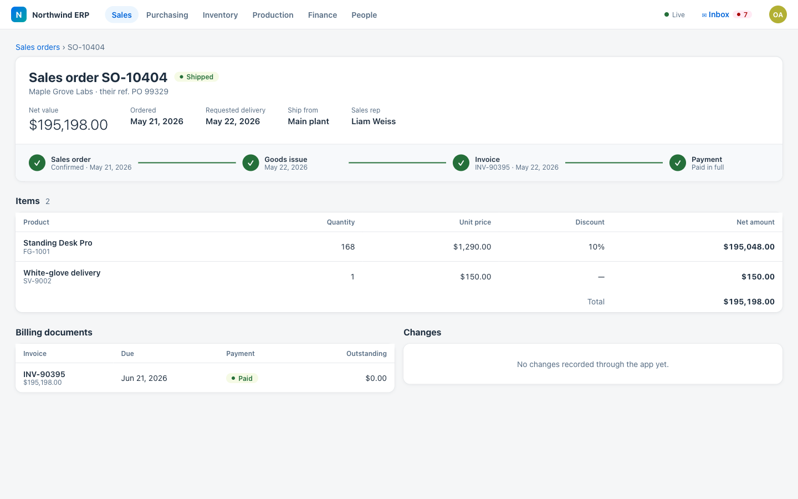 | 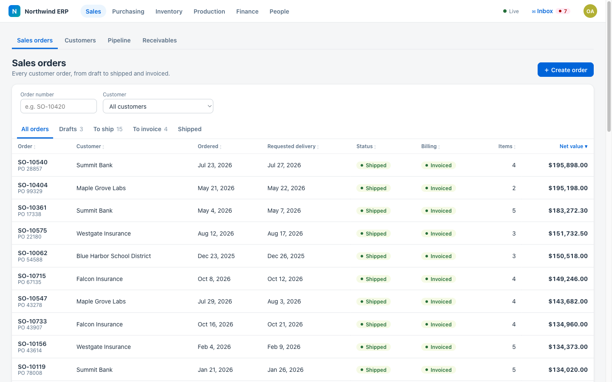 |
| 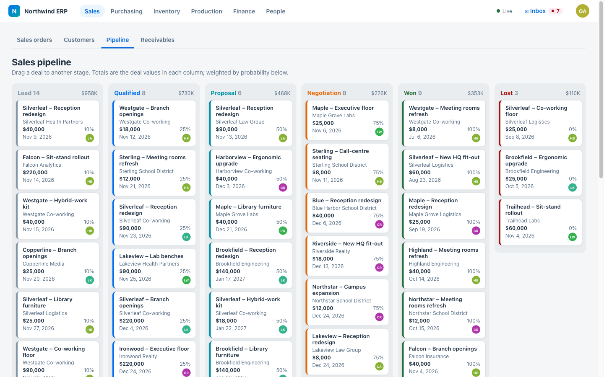 | 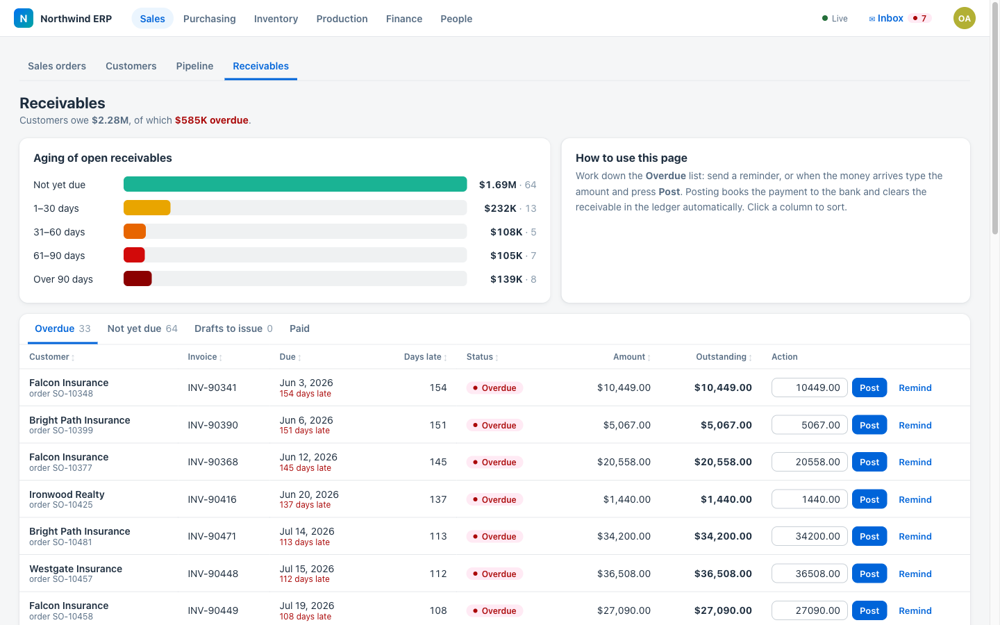 |
| 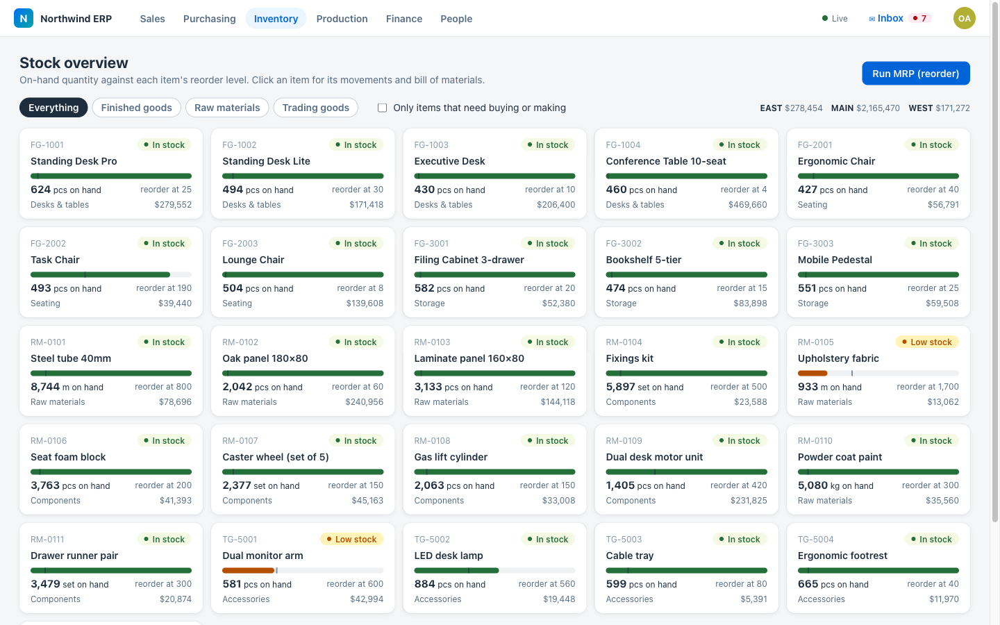 | 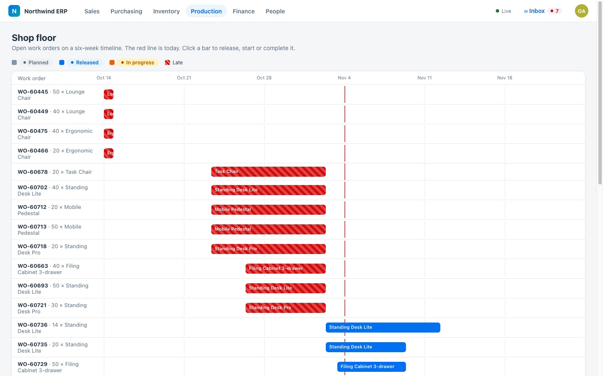 |
| 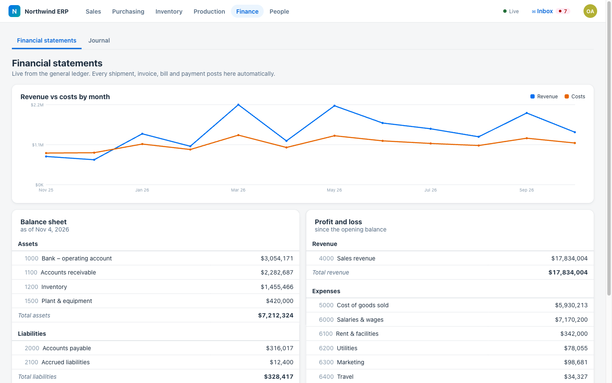 | 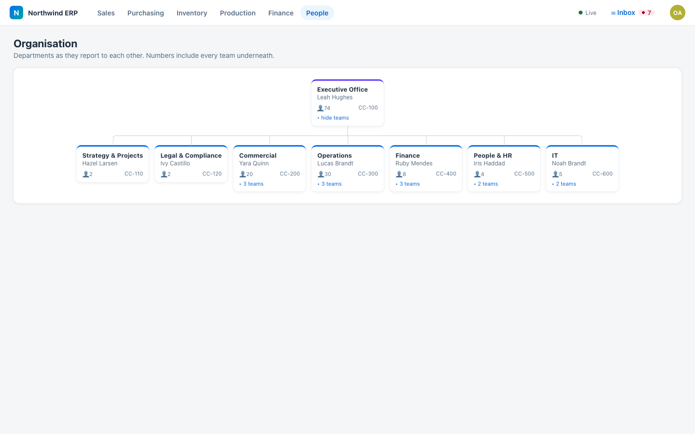 |

## Desktop app

The desktop app is built from the same tables, from the YAML in `page/`, `menu/`, `form/`
and `action/`.

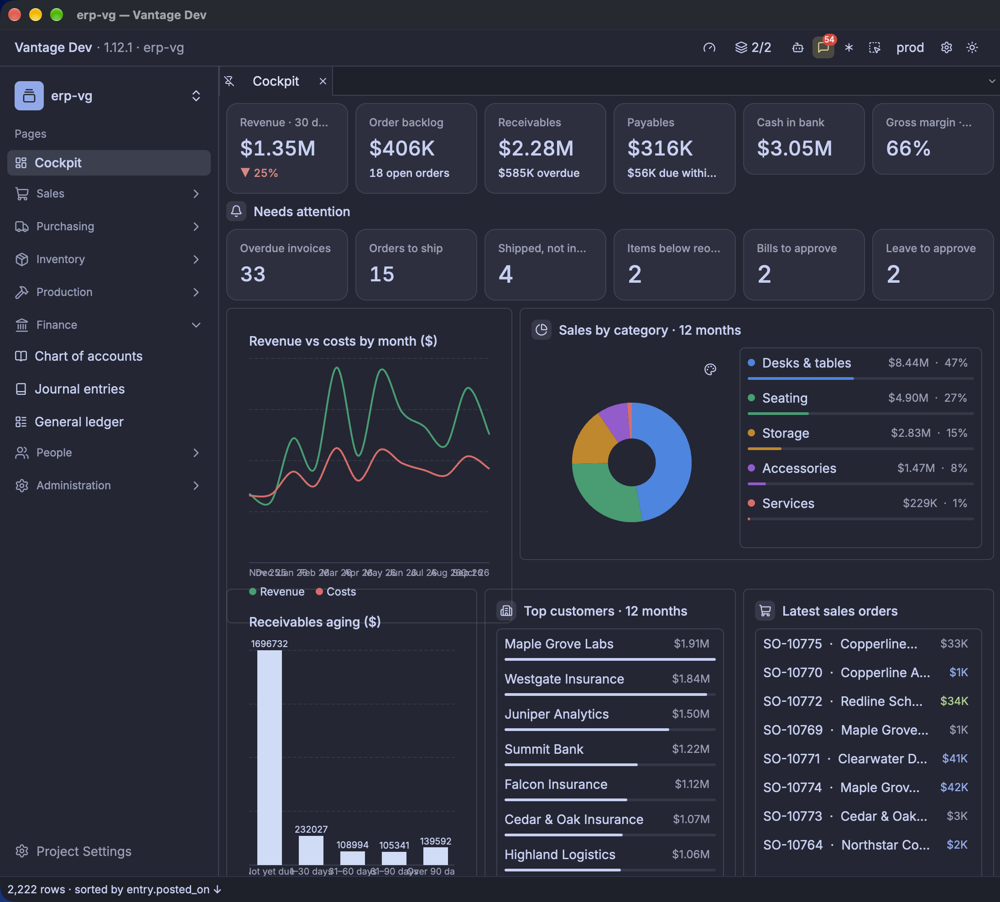

## How it fits together

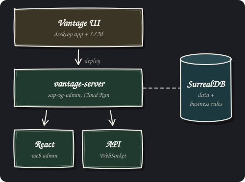

- **The app** is a Vantage project: tables, pages and actions in YAML, built in Vantage UI by
  its LLM agent. The desktop app runs from the same folder.
- **In production** it runs on `vantage-server`, the server Vantage UI runs locally, as the
  Cloud Run service `sap-vg-admin`. It serves the web admin and the WebSocket API it talks to.
- **SurrealDB** holds the data and the business rules (document numbers, ledger postings, stock
  moves, guards), so they hold for every client.

## Layout

| Path | What |
|---|---|
| `application.yaml` | App settings and profiles: `local` (desktop), `ci` (checks), `prod` (deployed) |
| `datasource/` | The SurrealDB connection. Its URL comes from `SECRET_SURREAL_URL` |
| `table/` | Tables, columns, references and rollups |
| `page/`, `menu/`, `form/`, `view/`, `layout/`, `action/` | Desktop app |
| `api/admin.yaml` | The API the web admin uses: 28 entities over a WebSocket |
| `web/admin/` | The web admin (React, Vite, `@vantage-ui/client`) |
| `tests/` | Schema, seed generator, loader, invariants, DB copy tool, WebSocket probe |
| `bench/`, `docs/benchmark.md` | Query benchmark: SurrealDB against other databases |
| `FEEDBACK.md` | Limits we hit in Vantage and SurrealDB, with measurements |
| `terraform/` | Deploy identity, secret and Cloud Run service (applied from `vantage-terraform`) |

## Running it locally

1. Open the folder in Vantage. It starts SurrealDB from `composer.yaml`.
2. Load the schema and sample data with `tests/load.sh`, then check the rules with
   `tests/invariants.sh`.
3. Vantage serves `api/admin.yaml` locally. Start the web admin from the Services panel to
   open it in a browser.

## Deploying

Every push to `main` that touches the app runs `.github/workflows/deploy-admin.yaml`. It
builds the image from the `Dockerfile` (the API and the built web admin on
`vantage-server`), pushes it to Artifact Registry and deploys it to the Cloud Run service
`sap-vg-admin` in `europe-west2`. It then smoke-tests the URL over HTTP and the WebSocket.
The workflow signs in to Google Cloud through Workload Identity Federation, so the repo
holds no keys.

Pull requests run `.github/workflows/checks.yaml`. It type-checks and tests the web app and
lints the workflows. It also starts a throwaway SurrealDB, loads the schema and data, checks
the business rules, and runs the API on `vantage-server` with the `ci` profile.

Production data is in SurrealDB Cloud (namespace `erp`, database `erp`). Its connection URL
is the Secret Manager secret `sap-vg-surreal-url`. `tests/copy_db.py` copied the local data
there and checked that both copies match.
